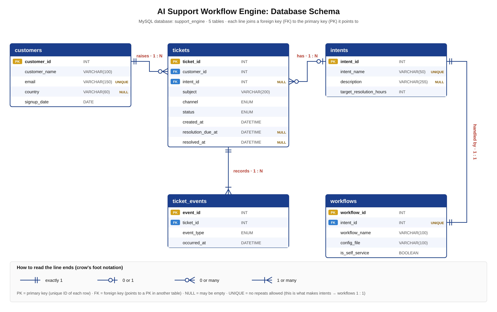

　　　# AI Support Workflow Engine

**Status: in progress**

Support teams spend a lot of time just sorting tickets: working out what each one is about, who should handle it, and what to tell the customer. This project automates that.

It takes incoming support tickets, uses Claude to work out what kind of problem each one is, sends it to the right team using a simple workflow file, and drafts a reply using only the company's own help articles.

## How it works

```
Customer sends a message
        ↓
Ticket is saved in MySQL
        ↓
Claude labels the problem type        (classify_tickets.py)
        ↓
The workflow file decides the team    (workflows/)
        ↓
Claude drafts a reply from the help   (draft_replies.py)
article for that problem
        ↓
SQL reports show what's working       (reporting_queries.sql)
```

## What's in here

| File / folder | What it is |
|---|---|
| `schema.sql` | Creates the database and its 5 tables |
| `intents_and_workflows.sql` | Adds the 9 problem types and the workflow for each |
| `generate_fake_data.py` | Fills the database with 200 customers and 2000 test tickets |
| `reporting_queries.sql` | 7 reports a support manager would look at |
| `classify_tickets.py` | Uses Claude to label tickets that don't have a problem type yet |
| `draft_replies.py` | Drafts replies for open tickets, grounded in the help articles |
| `workflows/` | 1 file per problem type: team, steps, self-service or not, when to escalate |
| `help_articles/` | 9 short help pages, the only facts the AI is allowed to use in replies |
| `WORKFLOW_AUTHOR_GUIDE.md` | How a non-technical person can write or change a workflow |
| `docs/` | Database diagrams |

## The database



5 tables: `customers`, `tickets`, `intents` (the 9 problem types and their target times), `workflows` (which file handles each problem) and `ticket_events` (the history of each ticket).

## Design choices

- **Workflows live in files, not in code.** A support lead can change how a problem is handled by editing a YAML or JSON file. No engineer needed.
- **Replies are grounded.** Claude only uses the help article for that problem, so it can't make up a policy the company doesn't have. If the article doesn't answer the question, the reply says a team member will follow up.
- **AI output is checked before it's saved.** A classification is only stored if it's 1 of the 9 real problem types.
- **Small model, small cost.** Sorting tickets is a simple job, so it uses Claude Haiku 5.5. Classifying 300 tickets cost a few cents.
- **Test small first.** Each script runs on a handful of tickets before running on everything.
- **No secrets in the code.** The API key is read from an environment variable and the MySQL password is typed in when the script runs.

## Results so far

The data is synthetic (realistic but made up), so these numbers show the system working, not real-world performance.

- **Baseline:** about half of the resolved tickets missed their deadline (492 late). Product defects were late most often.
- **Classification:** Claude labelled all 300 unclassified tickets, and every label was correct. The test tickets are short and clear, though, so this isn't a real accuracy number yet.
- **Draft replies:** replies used only facts from the help articles. When an article didn't cover a question, the draft handed it to a team member instead of guessing.

Example draft for "Do you ship abroad?":

> Hi Omar, thanks for reaching out! Yes, we ship to several countries: the United Kingdom, India, the United States, Germany and Canada. If you're somewhere else and have questions about shipping there, just let us know and a member of our team will follow up with you.

## What's next

- Save drafts in the database and mark tickets as routed or resolved
- Let an agent approve or edit a draft before it's sent
- Test classification on messier, real-world style tickets to get a true accuracy number
- Measure the self-service rate: how many tickets get solved with no human involved
- Ask for plain-text replies (drafts sometimes use markdown, which would look wrong in an email)

## How to run it

You'll need MySQL, Python 3 and a Claude API key.

1. Run `schema.sql`, then `intents_and_workflows.sql`, in MySQL.
2. Set up Python:
   ```bash
   python3 -m venv venv
   source venv/bin/activate
   pip install -r requirements.txt
   ```
3. Add your API key:
   ```bash
   export ANTHROPIC_API_KEY="your-key-here"
   ```
4. Run the scripts in order:
   ```bash
   python3 generate_fake_data.py
   python3 classify_tickets.py
   python3 draft_replies.py
   ```

Each script asks for your MySQL password when it starts.

## Built with

MySQL, Python, the Claude API (Haiku 5.5), YAML and JSON. 